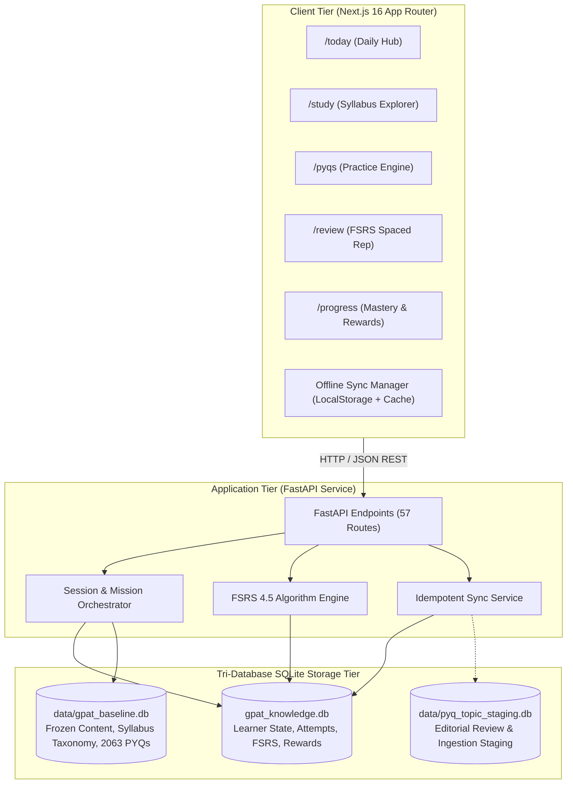

# GPAT Learning OS — System Architecture & Data Boundaries

**Version:** 1.0.0  
**Status:** Approved  
**Last Review:** 2026-10-20  

---

## 1. High-Level Architecture Overview

GPAT Learning OS is architected as an offline-first, client-server system designed for responsive interaction on mobile devices while maintaining rigorous data provenance.

---

## 2. Storage Boundaries (The Tri-Database Pattern)

To avoid corrupted content, accidental data wipes, and race conditions, the system enforces strict physical database boundaries:

### 2.1 `gpat_knowledge.db` (Authoritative Dynamic Learner State)
- **Scope:** Dynamic, user-specific data generated through active learning.
- **Key Tables:**
  - `student_attempts`: Every question attempt with chosen option, time spent, and correctness.
  - `fsrs_cards`: FSRS memory state (stability, difficulty, elapsed days, scheduled days, reps, state).
  - `study_sessions` & `study_session_items`: Daily missions, practice batches, and completion states.
  - `learning_events`: Granular append-only telemetry events for analytics.
  - `user_achievements` & `rewards_ledger`: Earned coins, badges, and unlockable rewards.
  - `sync_queue`: Queued offline payloads pending synchronization.
- **Safety Invariant:** Never deleted, wiped, or truncated during production operations or standard builds.

### 2.2 `data/gpat_baseline.db` (Authoritative Frozen Content & Taxonomy)
- **Scope:** Read-only content store representing the verified syllabus ontology and official questions.
- **Key Tables:**
  - `syllabus_nodes`: Formal syllabus hierarchy (Subject → Unit → Topic) with weightage.
  - `content_blocks`: Chunked syllabus concept summaries and high-yield notes.
  - `block_embeddings`: Vector embeddings for semantic search and concept retrieval.
  - `gpat_questions` / `pyqs`: 2,063 verified GPAT questions with official answers and explanations.
- **Safety Invariant:** All questions must link to a valid `syllabus_node_id`. Read-only at runtime.

### 2.3 `data/pyq_topic_staging.db` (Editorial Review & Staging)
- **Scope:** Ingestion sandbox for new question extraction and manual editorial review.
- **Key Tables:**
  - `staged_pyqs`: Draft questions pending taxonomy validation.
  - `editorial_reviews`: Review notes, approval flags, and topic mapping corrections.

---

## 3. Spaced Repetition Engine (FSRS 4.5)

The system replaces legacy SuperMemo SM-2 with the Free Spaced Repetition Scheduler (FSRS 4.5):
- **Core State Variables:**
  - $S$ (Stability): Days required for retention to fall from 100% to 90%.
  - $D$ (Difficulty): Inherent difficulty rating on a 1–10 scale.
  - $R$ (Retrievability): Probability of recalling an item at time $t$:
    $$R(t, S) = \left(1 + \text{factor} \times \frac{t}{S}\right)^{-\text{decay}}$$
- **Rating Responses:**
  1. `Again`: Total memory lapse. Stability resets, card reassigned to immediate learning step.
  2. `Hard`: Recalled with intense effort. Slight interval increase.
  3. `Good`: Successful recall at anticipated interval. Standard exponential growth.
  4. `Easy`: Effortless recall. Enhanced interval jump.

---

## 4. Offline Synchronization Protocol

The synchronization protocol guarantees that student progress made offline is never lost:
1. **Client Action Logging:** When offline, user interactions (attempts, reviews, mission completions) are written to client-side storage and backend `sync_queue`.
2. **Batch Push (`POST /api/study/sync`):** The client transmits the queued events in batches along with client timestamps and deterministic idempotency keys (`uuidv4`).
3. **Server Reconciliation:**
   - Evaluates `client_event_id` against processed records. If already present, skips execution and returns cached result (idempotency).
   - If novel, writes attempt to `student_attempts`, recalculates FSRS card state in `fsrs_cards`, and evaluates achievement milestones in a single atomic transaction.
4. **Pull Response:** Server returns updated coin balance, server timestamp, and freshly scheduled review items.
