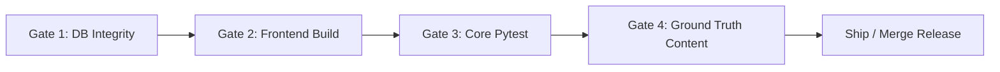

# GPAT Learning OS — Quality Gates & Verification Standards

**Version:** 1.0.0  
**Status:** Approved  
**Last Updated:** 2026-10-20  

---

## 1. Quality Gate Philosophy

Every modification to GPAT Learning OS must satisfy strict deterministic quality gates before deployment or milestone acceptance. Subjective "it looks fine" assessments are disallowed.

---

## 2. Release & Acceptance Gates



### Gate 1: Database Physical Integrity
- **Criterion:** All 3 SQLite databases must pass SQLite internal physical integrity verification without warnings or errors.
- **Command:**
  ```powershell
  python -c "import sqlite3; [assert sqlite3.connect(db).execute('PRAGMA integrity_check').fetchone()[0] == 'ok' for db in ['gpat_knowledge.db', 'data/gpat_baseline.db', 'data/pyq_topic_staging.db']]"
  ```
- **Threshold:** Zero integrity violations.

### Gate 2: Frontend Type Safety & Production Build
- **Criterion:** The Next.js frontend must compile via Turbopack, validate all TypeScript types, and generate all static pages without errors.
- **Command:**
  ```powershell
  npm --prefix web run build
  ```
- **Threshold:** Zero TypeScript errors; build exit code 0.

### Gate 3: Regression & Spaced Repetition Logic
- **Criterion:** Production readiness, personalized orchestration, PYQ flows, and reward rules must pass automated unit and integration tests.
- **Command:**
  ```powershell
  python -m pytest tests/test_production_readiness.py tests/test_phase3_personalized_orchestration.py tests/test_pyq_practice_flow.py tests/verification/test_progress_rewards.py tests/verification/test_daily_mission_flow.py -v
  ```
- **Threshold:** 100% pass rate (30/30 tests).

### Gate 4: Ground Truth Content Provenance
- **Criterion:** No synthetic question content may exist in `data/gpat_baseline.db`. Every question must possess verified option mappings, correct answers, and valid topic associations in `baseline_questions`.
- **Command:**
  ```powershell
  python -c "import sqlite3; con = sqlite3.connect('data/gpat_baseline.db'); c = con.execute('SELECT count(*) FROM baseline_questions WHERE question_text IS NULL OR length(trim(question_text)) < 10 OR correct_option NOT BETWEEN 0 AND 3').fetchone()[0]; assert c == 0, f'Found {c} invalid questions'"
  ```
- **Threshold:** Zero malformed questions; all 2,063 baseline questions pass structural validation.

---

## 3. UI/UX Impeccable Standards

All learner-facing interfaces must adhere to:
1. **Mobile Safe Area Respect:** Bottom bars and buttons must include `env(safe-area-inset-bottom)` padding to prevent overlap with device navigation bars.
2. **Instant Visual Feedback:** Quiz and practice answers must provide immediate feedback (success green pulse or subtle shake) without layout shifts.
3. **Honest Empty States:** A brand new user with 0 attempts must see clean guidance, not broken charts, `NaN%` labels, or mocked statistics.
4. **Reduced Motion Support:** All transitions and keyframe animations must respect `prefers-reduced-motion: reduce`.
