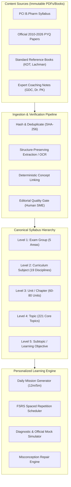

# Content Management Architecture & Universal Syllabus Tree

**Date:** 2026-10-18  
**Architecture Version:** 2.0 (Commercial Scale Ready, 5-User Pilot Deployed)  
**Project:** GPAT 2027 Learning OS (`C:\Users\Home\Downloads\PROJECTS\SRE_APP`)

---

## 1. Architectural Philosophy: The File is a Source, Not a Topic

In traditional educational applications, documents, PDFs, and question banks are frequently fragmented into separate silos:
- Book chapters are organized into folder trees.
- Daily Practice Problems (DPPs) live in separate question sets.
- Previous Year Questions (PYQs) live in standalone exam simulations.
- Flashcards and memory concepts live in an independent Leitner or FSRS deck.

This leads to content duplication, orphaned learning assets, and inconsistent student telemetry.

### The Unified Content Principle
In the GPAT 2027 Learning OS, **every learning asset links to a single, canonical, immutable syllabus tree**.
- A **source document** (PDF, reference book, lecture note, PYQ paper) is an *evidence artifact*.
- A single reference book (e.g., *Remington: The Science and Practice of Pharmacy*, *Goodman & Gilman*, or *K.D. Tripathi*) spans hundreds of distinct syllabus topics.
- A single **syllabus topic** aggregates multiple multimodal content assets:
  - 1 or more canonical reference book chapter extracts.
  - 2 to 5 curated class notes / summary plates.
  - 10 to 40 verified PYQs across 2010–2026.
  - 5 to 15 active recall flashcards with FSRS card states.
  - Common misconception traps identified from student error analysis.



---

## 2. Five-Tier Syllabus Hierarchy (Level 1 to Level 5)

To prevent confusion between university semester curricula and competitive exam blueprints, the taxonomy separates **Exam Area** from **Curriculum Subject**:

1. **Level 1 — Exam Area / Scoring Group:**
   - Aligns strictly with the National Board of Examinations in Medical Sciences (NBEMS) GPAT 2025 indicative distribution (5 broad areas: *Pharmaceutics & Allied*, *Pharmaceutical Chemistry & Allied*, *Pharmacology & Allied*, *Pharmacognosy & Allied*, *Other B.Pharm Subjects*).
2. **Level 2 — Curriculum Subject / Course Component:**
   - Aligns with the Pharmacy Council of India (PCI) B.Pharm Course Regulations (19 distinct academic disciplines: *Physical Pharmaceutics*, *Biopharmaceutics*, *Organic Chemistry*, *Biochemistry*, *Pharmacology*, *Anatomy & Physiology*, *Microbiology*, *Biotechnology*, etc.).
3. **Level 3 — Unit / Chapter:**
   - Formal pedagogical units within a curriculum course (e.g., *Unit I: Solubility of Drugs*, *Unit II: Micromeritics & Powder Rheology*).
4. **Level 4 — Topic:**
   - Discrete, testable concept clusters with stable slug IDs (e.g., `pharmaceutics__physical_pharmacy__micromeritics_and_powder_rheology`).
5. **Level 5 — Subtopic & Learning Objective:**
   - Atomic competencies and operational definitions (e.g., *Anderson Pipette sedimentation method*, *Stokes Law limiting conditions*, *Hausner ratio & Carr index calculation*).

---

## 3. Storage Architecture: 5-User Pilot to Commercial SaaS

```
+------------------------------------------------------------------------+
|                              LOCAL HOST / PWA                          |
|  - IndexedDB for Offline Attempt Queue & Content Cache                 |
|  - Service Worker (sw.js) with Dynamic Network-First Strategy          |
+------------------------------------------------------------------------+
                                    |
                                    v [HTTP / REST]
+------------------------------------------------------------------------+
|                           FASTAPI BACKEND                              |
|  - Single-Process Async FastAPI Application                            |
|  - Pydantic v2 Request / Response Validation                           |
|  - Role-Based Middlewares (Pilot Auth, Admin Secret)                   |
+------------------------------------------------------------------------+
                                    |
                                    v
+------------------------------------------------------------------------+
|                          STORAGE SUBSYSTEMS                            |
|                                                                        |
|  1. Immutable File Storage:                                            |
|     - baseline/sources/ (Original PDFs, Books, DPPs)                   |
|     - baseline/media/ (Verified SVG / High-Res PNG plates)             |
|                                                                        |
|  2. Canonical Baseline SQLite (data/gpat_baseline.db):                 |
|     - syllabus_versions, subjects, curriculum_subjects                 |
|     - units, baseline_topics, learning_objectives                      |
|     - baseline_questions (2,063 verified MCQs)                         |
|     - baseline_chunks (505 passages with 384-dim embeddings)           |
|                                                                        |
|  3. Learner Knowledge & State SQLite (gpat_knowledge.db):              |
|     - pilot_learners, pilot_config, pilot_feedback                     |
|     - student_attempts, fsrs_cards, concept_memory_state               |
|     - study_sessions, learning_events, mock_exams                      |
|                                                                        |
|  4. Staging & Editorial SQLite (data/pyq_topic_staging.db):            |
|     - staged_topic_mappings (137 candidate mappings)                   |
|     - editorial_reviews (Human SME decision logs)                      |
+------------------------------------------------------------------------+
```

### Commercial Scaling Transition Path
- For the **5-user pilot**, SQLite in WAL mode with connection pooling executes queries with $< 5\text{ ms}$ latency and sustains 20 simultaneous concurrent users without lock errors.
- To scale to **10,000+ users**, the data dictionary and relational schemas are 100% ANSI SQL compliant:
  - Migrate `gpat_baseline.db` to managed read-replica PostgreSQL.
  - Migrate `gpat_knowledge.db` to a sharded / multi-tenant PostgreSQL cluster.
  - Replace dense BLOB vector lookups with `pgvector` or Qdrant without altering business logic or API contracts.
