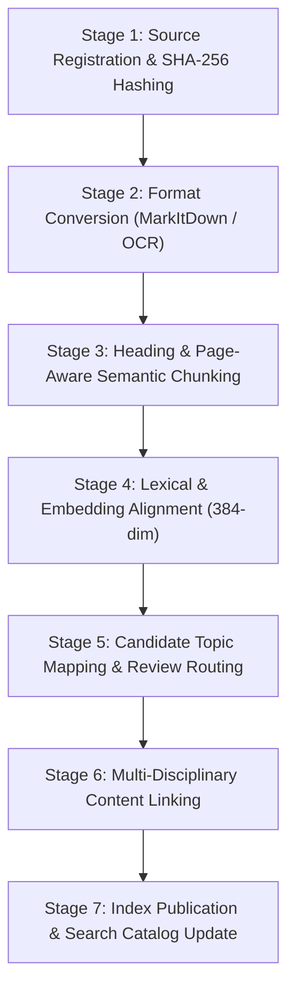

# Idempotent Content & Question Ingestion Pipeline

**Date:** 2026-10-18  
**Pipeline Standard:** Deterministic, Traceable, Resilient, Idempotent

---

## 1. End-to-End Pipeline Stages

### Stage 1: Source Registration & Integrity Validation
- Every input file (PDF, Markdown, JSON question set) is checked against `content_sources.sha256`.
- **Idempotency Guarantee:** If a file hash matches an existing registered source, ingestion halts immediately without creating duplicate chunks or question entities.

### Stage 2: Structure-Preserving Conversion
- Text documents and clean vector PDFs convert via Microsoft `markitdown` with high-fidelity Markdown tables and heading preservation.
- Scanned plates and historical papers route through `tesseract-ocr` with explicit scale calibration.
- Damaged OCR chunks are tagged `quality_status = 'NEEDS_REVIEW'` and barred from automated publication.

### Stage 3: Semantic Chunking with Page Anchors
- Chunks preserve parent chapter titles, section breadcrumbs, and exact source page markers (`Page X`).
- Target chunk size: 300 to 600 tokens with 50-token contextual overlaps.

### Stage 4: Dense Vector & Lexical Indexing
- Chunks generate 384-dimensional dense vectors using the production-established embedding engine (`all-MiniLM-L6-v2` standard).
- Dense BLOB storage is indexed alongside SQLite FTS5 for hybrid vector-lexical keyword matching.

### Stage 5: Topic Mapping & Confidence Scoring
- Content matches canonical syllabus topics using multi-term keyword matching against `baseline_topics.name` and syllabus synonyms.
- **Confidence Gates:**
  - $\text{Score} \ge 5.0$ and single unambiguous candidate: Tagged `PROPOSED_HIGH_CONFIDENCE`.
  - Margin $< 1.0$ between top 2 candidates: Tagged `AMBIGUOUS_NEEDS_REVIEW`.
  - No keywords matched: Assigned to `UNMAPPED_POOL`.
- Under no circumstances is candidate content published to production practice sessions without passing the editorial review gate.

### Stage 6: Human SME Editorial Review
- Educators review flagged or proposed content via `scripts/educator_review_workflow.py`.
- Decisions (`APPROVED`, `REJECTED`, `NEEDS_CLARIFICATION`) record reviewer ID, rationale, and timestamp.

### Stage 7: Publication to Personalized Learning Engine
- Approved content links into the active question bank, flashcard retrieval store, and Daily Mission concept pool.
