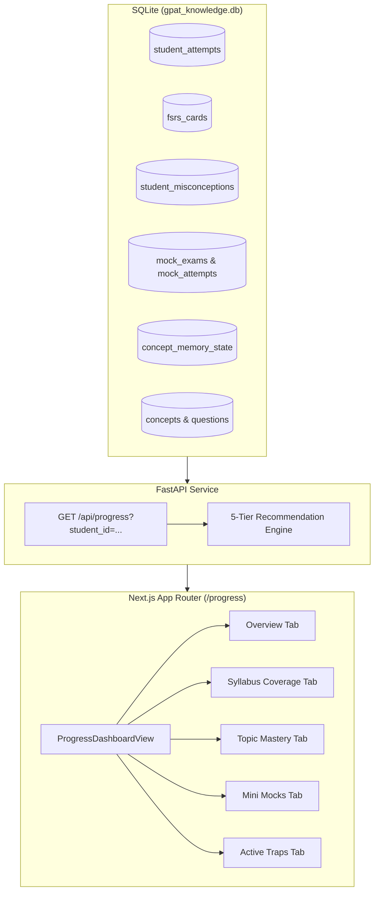

# Phase 5E: Progress, Readiness & Next-Step Guidance Specification

## 1. Overview & Objective
The Progress and Readiness system answers four essential learner questions:
1. **What have I actually studied?** (Chronological activity, daily vs historical boundaries, question attempts and accuracy).
2. **What am I retaining, and what am I forgetting?** (FSRS v4.5 spaced repetition intervals, due reviews, overdue cards, and upcoming workload forecast).
3. **Which topics need more work?** (Subject and domain performance, verified topic mastery states, active misconceptions, and distractor traps).
4. **What should I do next?** (Deterministic 5-level recommendation hierarchy with transparent rationale).

The system relies strictly on verified persisted database records in `gpat_knowledge.db`. No client-side metric fabrication, decorative ungrounded charts, or speculative readiness predictions are permitted.

---

## 2. Core Non-Negotiables & Rules

### A. Non-Fabrication of Metrics
- Unassessed topics are categorized strictly as `UNASSESSED`. They are never treated as weak, failing, or zero-percent mastered.
- Opening a syllabus topic or viewing content does not confer mastery; mastery requires verified question attempts and spaced memory evidence.
- A mini mock score is an authoritative targeted diagnostic (+4 for correct, -1 for incorrect, 0 for unattempted) and must never be portrayed as a predictive official GPAT score.

### B. Time-Window Distinctions
- **Today's Window:** Tracks activity recorded on the current calendar date (`date(created_at) = CURRENT_DATE`).
- **Historical Records:** Tracks all-time logged events and sessions across the learner's journey.

### C. Deterministic 5-Level Recommendation Hierarchy
When deriving the single primary recommended next action:
1. **Priority 1 — Overdue & Due FSRS Reviews:** `due_reviews > 0`. Risk of memory decay is elevated. Direct CTA to `/review`.
2. **Priority 2 — Active Misconceptions & Traps:** Repeated distractor traps caught during attempts. Direct CTA to `/today?mode=repair&concept={id}`.
3. **Priority 3 — Weak Assessed Performance:** Topics with attempts $\ge 1$ and accuracy $< 60\%$. Direct CTA to practice mode `/learn?topic={id}`.
4. **Priority 4 — High-Yield Unassessed Areas:** Topics with high importance scores and eligible questions with zero attempts. Direct CTA to `/learn?topic={id}`.
5. **Priority 5 — Daily Study Mission Fallback:** Balanced 12-minute mission on `/today`.

---

## 3. Data Flow & System Architecture



---

## 4. API Telemetry Schema (`GET /api/progress`)

```json
{
  "student_id": "student_01",
  "summary": {
    "total_concepts": 38,
    "mastered_concepts": 1,
    "total_attempts": 3,
    "total_correct": 3,
    "total_incorrect": 0,
    "overall_accuracy_percent": 100.0,
    "completed_sessions": 0,
    "latest_activity_date": "2026-10-18 21:07:37",
    "active_misconceptions": 0,
    "repaired_misconceptions": 0,
    "recurring_misconceptions": 0,
    "active_study_days": 2,
    "status": "Active Learner"
  },
  "daily_activity": [
    {
      "date": "2026-09-24",
      "attempts": 1,
      "correct": 1,
      "incorrect": 0,
      "accuracy_percent": 100.0,
      "avg_time_sec": 12.0
    }
  ],
  "fsrs_workload": {
    "due_reviews": 0,
    "overdue_reviews": 0,
    "total_cards": 1,
    "learning_cards": 0,
    "review_cards": 1,
    "forecast_3_days": 0,
    "forecast_7_days": 0,
    "forecast_14_days": 0
  },
  "domain_performance": [
    {
      "domain_id": "general_pharmacology",
      "attempts": 3,
      "correct": 3,
      "incorrect": 0,
      "accuracy_percent": 100.0
    }
  ],
  "syllabus_coverage": [
    {
      "domain_id": "autonomic_pharmacology",
      "total_concepts": 11,
      "assessed_concepts": 0,
      "unassessed_concepts": 11,
      "coverage_percent": 0.0,
      "attempts": 0,
      "correct": 0
    }
  ],
  "recommended_next_action": {
    "type": "explore",
    "title": "Explore Unassessed Area: Anticholinesterase Agents",
    "description": "High-yield concept in autonomic pharmacology with 2 eligible practice questions.",
    "cta_label": "Explore Anticholinesterase Agents",
    "cta_href": "/learn?topic=ans_anticholinesterases",
    "rationale": "Fourth priority: High-importance syllabus topic with zero recorded assessments."
  },
  "mock_history": [
    {
      "id": "mock_e57c22f2d5",
      "title": "Test Autonomic Mini Mock",
      "blueprint_name": "PERSONALIZED_MINI_MOCK",
      "total_questions": 5,
      "score": 4.0,
      "score_percent": 20.0,
      "accuracy_percent": 100.0,
      "submitted_at": "2026-10-18T21:21:33.293449+00:00"
    }
  ],
  "concepts": [...]
}
```

---

## 5. Known Limitations & Documented Metric Boundaries
1. **Textbook Reading Time:** The platform currently measures response time on attempted questions and session durations. Total passive reading time in the study explorer is omitted because unmonitored browser idle time introduces statistical noise.
2. **Predictive Official GPAT Rank/Score:** Mini mocks and practice sets cover subsets of the syllabus. The platform deliberately avoids extrapolating a subset score into an official GPAT rank prediction.
3. **Automated Offline Sync Queue:** Synchronized client events are recorded when the server confirms receipt. Until server confirmation is received, events remain pending in IndexedDB and are not displayed as authoritative records.
