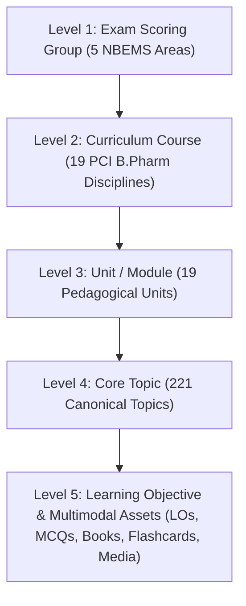

# GPAT Learning OS — Syllabus Explorer Specification (Phase 5B)

**Version:** 2.0 (Production-Grade)  
**Date:** 2026-10-19  
**Status:** Approved & Implemented  
**Governing Document:** `BEST_GPAT_UX.md`  
**Target View:** `/study`

---

## 1. Information Architecture & Canonical 5-Tier Hierarchy

The Syllabus Explorer organizes all learning content into a 5-tier taxonomy that accurately distinguishes competitive examination scoring groups from university curriculum courses:



### Key Architectural Truths
1. **PCI Regulations vs. NBEMS Blueprint:**
   - The Pharmacy Council of India (PCI) B.Pharm regulations mandate **19 distinct courses** across 8 semesters (e.g., *Physical Pharmaceutics*, *Biopharmaceutics*, *Biochemistry*, *Pharmacology*, *Microbiology*).
   - The National Board of Examinations in Medical Sciences (NBEMS) GPAT pattern groups test questions into **5 indicative scoring areas** (*Pharmaceutics & Allied*, *Pharmaceutical Chemistry & Allied*, *Pharmacology & Allied*, *Pharmacognosy & Allied*, *Other B.Pharm Subjects*).
   - The UI makes this distinction explicit in the header metadata and avoids flattening university courses into fake exam subjects.
2. **Editorial Staging Separation:**
   - All 221 current topics are marked with `extraction_status = 'SOURCE_DERIVED'` and `verification_status = 'UNVERIFIED'`.
   - The UI displays an explicit **"Needs Mapping Review"** badge and an editorial advisory notice rather than masquerading candidate tracker items as official syllabi.
3. **Zero Synthetic Metrics:**
   - No fabricated completion percentages, streaks, or fake difficulty metrics are rendered.
   - Learner mastery states (*Needs Repair*, *Mastered*, *Unassessed*) are computed exclusively from genuine `student_attempts` and `learning_events` returned by `/api/progress`.

---

## 2. Page Structure & Components

### 2.1 Syllabus Explorer (`web/src/app/study/page.tsx`)
- **Active Authorities Banner:** Surfaces regulatory versions (`NBEMS GPAT 2025` and `PCI B.Pharm 2024`) directly from `syllabus_versions`.
- **Search & Multi-Facet Filters:** Real-time search across topics, units, and subjects with pills for:
  - *All Topics*
  - *With Verified Questions* (filters to topics with baseline question linkages)
  - *Needs Repair* (accuracy < 60% or active misconceptions)
  - *Mastered* (stability $\ge$ 7 days, $\ge 80\%$ accuracy)
  - *Unassessed* (0 recorded learner attempts)
- **Subject Color Themes & Monochromatic Left Borders:**
  - Pharmacology $\rightarrow$ Forest Green (`#4ADE80`)
  - Pharmaceutics $\rightarrow$ Sky Blue (`#60A5FA`)
  - Pharmaceutical Chemistry $\rightarrow$ Warm Amber (`#FBBF24`)
  - Pharmacognosy $\rightarrow$ Muted Violet (`#C084FC`)
  - Other Subjects $\rightarrow$ Teal Cyan (`#2DD4BF`)
- **Deep-Linking & Browser History:** Reads `?topic=<topic_id>` from the URL on load and updates the URL via `window.history.replaceState` when switching topics.
- **Responsive Layout:**
  - Desktop: 5-column navigation tree + 7-column multimodal topic panel.
  - Mobile (393px, Redmi Note 11 target): Single-column accordion with comfortable $\ge 40$px touch targets and full back-navigation.

### 2.2 Multimodal Topic Workspace (`web/src/components/study/topic-detail-panel.tsx`)
- **Overview Tab:**
  - Quick launch buttons: *Start Daily Mission* (links to `/today`) and *Review Due Cards* (links to `/review`).
  - Real asset counters: Text Extracts, Questions, Objectives, Flashcards.
  - Core Bloom's taxonomy learning competencies preview with clinical pearls.
- **Learn Tab:**
  - Verified textbook extracts with source document citations (`source_id`), page numbers, and heading paths.
  - PCI Bloom's learning objectives with rules/formulas.
- **Practice Tab:**
  - Practice questions and historical GPAT PYQs.
  - Cognitive levels, difficulty tags, and direct *Practice in Daily Mission* links.
  - Truthful empty state linking to `/pyqs` when no items are mapped.
- **Resources Tab:**
  - Scientific figures, chemical structures, and dose-response curve graphs from `baseline_media` with captions, alt text, and rights status.
  - Active recall flashcard front/back pairs.
  - Canonical content source provenance registry.
- **"Add to Study Plan" Bridge:**
  - Synchronizes with `localStorage.getItem("gpat_learner_study_plan_v1")`, allowing syllabus topics to be scheduled into the Daily Home study plan.

---

## 3. Data Contracts & Endpoints

### 3.1 `GET /api/syllabus/tree`
Returns the complete 5-tier taxonomy with active versions:
```json
{
  "syllabus_versions": [
    {
      "version_id": "nbems_gpat_2025",
      "authority_name": "National Board of Examinations in Medical Sciences",
      "title": "NBEMS GPAT 2025 Indicative Pattern",
      "effective_year": 2025,
      "status": "ACTIVE"
    }
  ],
  "total_exam_groups": 5,
  "total_curriculum_courses": 19,
  "total_units": 19,
  "total_topics": 221,
  "total_verified_topics": 0,
  "total_needs_review_topics": 221,
  "tree": [ ... ]
}
```

### 3.2 `GET /api/syllabus/topic/{topic_id}`
Returns multimodal assets for the selected topic:
```json
{
  "topic": {
    "topic_id": "pharmaceutics__physical_pharmacy__solubility",
    "name": "Solubility",
    "subject_id": "pharmaceutics",
    "curriculum_subject_id": "pharmaceutics__physical_pharmacy",
    "curriculum_name": "Physical Pharmaceutics",
    "pci_course_code": "BP302T / BP403T",
    "semester_recommended": 3,
    "exam_subject_name": "Pharmaceutics and Allied Subjects",
    "unit_number": 1,
    "unit_title": "Physical Pharmaceutics",
    "verification_status": "UNVERIFIED"
  },
  "content_chunks": [ ... ],
  "questions": [ ... ],
  "learning_objectives": [ ... ],
  "flashcards": [ ... ],
  "media": [ ... ],
  "sources": [ ... ],
  "chunk_count": 0,
  "question_count": 0,
  "objective_count": 1,
  "flashcard_count": 1,
  "media_count": 0
}
```
