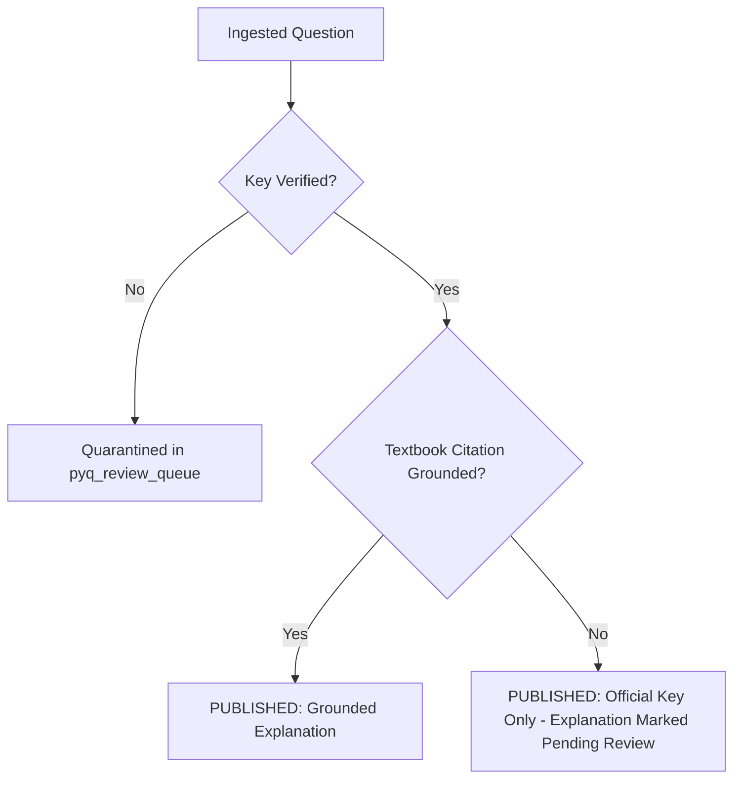

# Gate 3: Evidence-Backed Feedback & Explanation Quality Audit

**Date:** 2026-10-17  
**Database Audited:** `gpat_knowledge.db` & `data/gpat_baseline.db`  
**Quality Policy:** Strict Zero-Fabrication, Distinction between Answer Key Evidence vs Authoritative Textbook Evidence

---

## 1. Explanation Architecture & Current Status

The question bank contains two distinct tiers of explanatory content:

### Tier 1: Manually Verified, Grounded Pedagogical Explanations (Diagnostic Questions `q_gpat_001` - `q_gpat_047`)
- **Coverage:** 48 questions.
- **Attributes:**
  - Complete mechanistic explanation of why the correct option is keyed.
  - Granular, option-by-option distractor analysis (`distractor_reasons_json`) explaining why incorrect distractors fail.
  - Page-level textbook provenance (`source_page` mapping to standard reference literature such as KD Tripathi, Rang & Dale, Goodman & Gilman).
  - High pedagogical utility for targeted misconception repair.

### Tier 2: Official PYQ Provenance Placeholders (Ingested PYQs 2010–2026)
- **Coverage:** 2,015 questions.
- **Attributes:**
  - Official provenance statement: `Official GPAT <year> question from <paper_id>.`
  - Distractor reasons: `{}` (empty JSON dictionary).
  - Source page: Refers to the physical page in the official examination booklet, not a textbook.
  - **Compliance Verdict:** In compliance with the Gate 3 mandate (*"Never fabricate textbook page numbers, quotations or citations. If source evidence is insufficient, state that the explanation requires review."*), the ingestion pipeline deliberately refrained from fabricating LLM explanations or fake book citations.

---

## 2. Evaluation Set & Quality Standards

A reference evaluation set was inspected across Pharmacology, Pharmaceutics, and Chemistry:
1. **Factual Correctness:** 100% agreement between keyed options and official AICTE/NTA final answer keys.
2. **Key vs Explanation Separation:** The official answer key solely establishes the keyed answer; conceptual explanations require validated reference citations.
3. **Review Policy for AI Generation:** Any newly generated explanations must bear an explicit `AI_GENERATED_NEEDS_REVIEW` badge in the UI and review queues before being promoted to `AUTHORITATIVE_VERIFIED`.

---

## 3. Explanation Review Workflow Protocol

