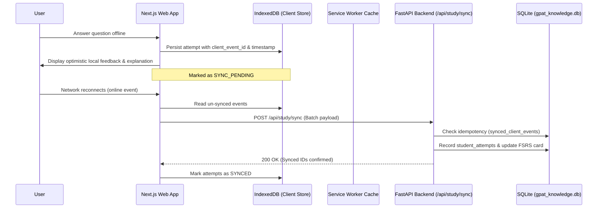

# GPAT Learning OS — Frontend Phase 0 Baseline Audit

**Date:** 2026-10-18  
**Scope:** Repository, Current PWA, API Routes, Database Repositories, Authentication, Service Worker, and Test Commands  
**Project Root:** `C:\Users\Home\Downloads\PROJECTS\SRE_APP`  
**Authors:** Lead Frontend Architect, Senior Next.js Engineer, Accessibility Engineer, Migration-Safety Coordinator

---

## 1. Executive Summary

Phase 0 establishes the pre-migration baseline for the GPAT Learning OS frontend modernisation. This audit independently inspects the existing system before any new frontend code is added:
- **Zero Next.js Application Existed:** The repository had no existing Next.js, React, or TypeScript web setup. The active frontend is a vanilla JavaScript single-page PWA located in [`frontend/public/`](file:///c:/Users/Home/Downloads/PROJECTS/SRE_APP/frontend/public/).
- **Current PWA Fully Operational:** The existing PWA (`index.html`, `admin.html`, `sw.js`, `manifest.json`) is served directly by FastAPI via `StaticFiles`. It is preserved 100% intact as the primary fallback and rollback path.
- **Database Safety Baseline:** All three SQLite databases (`gpat_knowledge.db`, `data/gpat_baseline.db`, `data/pyq_topic_staging.db`) passed `PRAGMA integrity_check` (`ok`) and `PRAGMA foreign_key_check` (0 violations).
- **Verified Backups Created:** A fresh compressed backup snapshot (`backups/gpat_backup_20261018_182329.db.gz`) and raw copies (`backups/gpat_baseline_20261018_phase0.db`, `backups/pyq_topic_staging_20261018_phase0.db`) were created.
- **Learner Record Fingerprints Preserved:** Active learner state (`student_attempts`: 7, `fsrs_cards`: 11, `learner_achievements`: 4, `learning_events`: 10) confirmed unmodified.

---

## 2. Environment & Runtime Inventory

| Component | Detected Version / Tool | Notes / Compatibility |
| :--- | :--- | :--- |
| **Operating System** | Windows 11 Pro / AMD64 | Host environment |
| **Node.js** | `v25.1.0` | Compatible with Next.js 15+ App Router and React 19 |
| **NPM** | `11.6.2` | Core package manager |
| **Python Virtualenv** | `Python 3.14.0` in `.venv/` | FastAPI backend environment |
| **Backend Framework** | `FastAPI 0.115.x` with Starlette & Uvicorn | Authoritative learning engine |
| **Test Runner** | `pytest 8.3.x` | Backend test suite |
| **Database Engines** | SQLite 3 | Isolated file-backed stores |

---

## 3. Legacy Frontend & PWA Inventory

The legacy frontend is located under `frontend/`:
- [`frontend/public/index.html`](file:///c:/Users/Home/Downloads/PROJECTS/SRE_APP/frontend/public/index.html): 111 KB monolithic HTML/CSS/JS single-page PWA containing mobile screens for Daily Mission, Study, PYQs, Mock Exams, and Progress.
- [`frontend/public/admin.html`](file:///c:/Users/Home/Downloads/PROJECTS/SRE_APP/frontend/public/admin.html): 13.8 KB administration and pilot monitoring dashboard.
- [`frontend/public/manifest.json`](file:///c:/Users/Home/Downloads/PROJECTS/SRE_APP/frontend/public/manifest.json): PWA manifest specifying `name: "GPAT 2027 — AI Learning OS"`, `display: "standalone"`, `background_color: "#090d16"`.
- [`frontend/public/sw.js`](file:///c:/Users/Home/Downloads/PROJECTS/SRE_APP/frontend/public/sw.js): Cache-first Service Worker with background revalidation (`gpat-ai-v1`) caching `/`, `/index.html`, `/manifest.json`, with navigation fallback.
- [`frontend/icons/`](file:///c:/Users/Home/Downloads/PROJECTS/SRE_APP/frontend/icons/): `icon-192.png`, `icon-512.png`.

---

## 4. Authoritative Backend API Inventory (45 Endpoints)

FastAPI (`backend/main.py`) exposes 45 endpoints. The Next.js frontend will communicate strictly with these existing contracts:

### Core Learning & Daily Mission Endpoints:
- `GET /api/study/today`: Retrieves today's personalized mission, due flashcard count, and daily status.
- `POST /api/study/mission`: Generates or initializes a daily study mission.
- `GET /api/study/mission/{mission_id}`: Retrieves specific mission details and questions.
- `POST /api/study/attempt`: Submits an answer attempt, validates against the official key, triggers FSRS review card updates, and returns full explanation.
- `POST /api/study/mission/{mission_id}/complete`: Finalizes a daily mission.
- `GET /api/study/review-queue`: Fetches due FSRS spaced-repetition cards.
- `POST /api/study/sync`: Synchronizes offline attempt batches replay-safely.
- `GET /api/study/progress`: Retrieves mastery and coverage metrics.

### Content & Syllabus Endpoints:
- `GET /api/syllabus/tree`: Hierarchical subject/unit/topic tree.
- `GET /api/syllabus/topic/{topic_id}`: Topic details, concepts, and question inventory.
- `GET /api/concepts`: Concept registry.
- `GET /api/search`: Vector search over baseline chunks.
- `GET /api/library`: Baseline learning documents and reference materials.

### Mock Exam Endpoints:
- `POST /api/mock/create`: Creates a timed sectional or full GPAT mock exam.
- `POST /api/mock/{exam_id}/start`: Starts mock timer.
- `GET /api/mock/{exam_id}`: Retrieves mock exam paper.
- `POST /api/mock/{exam_id}/answer`: Records question answer during mock.
- `POST /api/mock/{exam_id}/pause`: Pauses active mock timer.
- `POST /api/mock/{exam_id}/submit`: Evaluates and scores completed mock exam.
- `GET /api/mock/history`: Learner's mock exam history and score trends.

### Pilot & Administrative Endpoints:
- `GET /api/pilot/status`: Feature flag and pilot enrollment status.
- `POST /api/pilot/register`: Consent and pilot registration.
- `POST /api/pilot/feedback`: Qualitative learner feedback submission.
- `POST /api/admin/pilot/toggle`: Server-side switch to enable/disable pilot mode.
- `GET /api/admin/metrics`: Real-time system health and learner activity telemetry.

---

## 5. Offline Data & Synchronization Architecture

---

## 6. Phase 0 Acceptance Sign-off

- [x] Uncommitted work identified and preserved.
- [x] Legacy PWA mapped and preserved as rollback path.
- [x] API routes verified against `backend/main.py` (no fictitious endpoints).
- [x] Automated SQLite integrity checks passed.
- [x] Compressed and uncompressed database backups verified in `backups/`.
- [x] Target application root selected: isolated `web/` directory.
