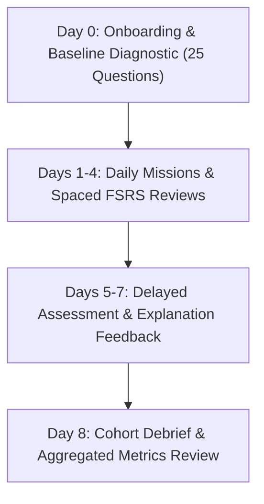

# Phase 15: Controlled Pilot Plan

**Date:** 2026-10-18  
**Cohort Size:** 5 to 10 consenting pharmacy students  
**Pilot Duration:** 7 to 14 days  
**Target Examination:** GPAT 2027

---

## 1. Pilot Objectives & Hypotheses

1. **Operational Reliability:**
   - Verify that the FastAPI backend and PWA client operate without unhandled exceptions ($< 0.1\%$ error rate) and maintain median latency $< 200\text{ ms}$.
2. **Learning Engagement & Usability:**
   - Measure daily mission completion rates (12-minute default vs. 5-minute shorter mission toggle).
3. **Retrieval Practice & Delayed Recall:**
   - Observe baseline assessment accuracy compared to a matched delayed assessment conducted 5 to 7 days later.
   - *Scientific Note:* Score differences in a 5–10 learner uncontrolled cohort will be reported strictly as descriptive observational metrics, not causal claims of learning efficacy.
4. **Explanation Quality & Feedback:**
   - Capture learner ratings and text comments on distractor explanations, OCR clarity, and chemical structure images.

---

## 2. Participant Onboarding & Ethical Safeguards

1. **Informed Consent Protocol:**
   - Participants receive an in-app consent disclosure detailing:
     - Study purpose (educational software usability and memory retention evaluation).
     - Data collected (anonymized response times, confidence ratings, and review completion).
     - Voluntary participation with right to withdraw at any time.
2. **Pseudonymous Enrollment:**
   - No names, college roll numbers, email addresses, or phone numbers are accepted or stored.
   - Learner identity is assigned via cryptographic tokens (`plt_learner_<8 hex>`).
3. **Strict Cohort Cap:**
   - Capped at 10 active learners. Requests exceeding 10 are rejected with HTTP 403.

---

## 3. Cohort Schedule & Workflow

- **Day 0 (Baseline Assessment):**
  - Learners take a 25-question sprint diagnostic exam (`GPAT_PROVISIONAL_MOCK_25`) spanning high-yield concepts across Pharmacology, Pharmaceutics, Pharmaceutical Chemistry, and Pharmacognosy.
- **Days 1–4 (Daily Spaced Retrieval):**
  - Learners complete daily 12-minute missions (6–8 targeted questions).
  - Spaced reviews scheduled according to the FSRS model.
- **Days 5–7 (Delayed Recall & Evaluation):**
  - Learners take a matched 25-question delayed assessment covering overlapping concept nodes to evaluate retention decay.
  - Learners submit structured feedback on question explanations.
- **Day 8 (Pilot Conclusion):**
  - Administrator exports aggregated metrics and initiates debrief.

---

## 4. Immediate Stop Gates (Circuit Breakers)

The pilot must be immediately paused via `POST /api/admin/pilot/toggle {"enabled": false}` if any of the following occur:
1. **Data Exposure:** Any cross-learner data leakage or unauthorized access to student attempts.
2. **Database Corruption:** Integrity check failure or unexpected foreign-key violation.
3. **Severe Error Spike:** Unhandled 5xx API error rate exceeding $1.0\%$ over 50 consecutive requests.
4. **Answer Key Discrepancies:** More than 2 verified errors reported in question answer keys.
