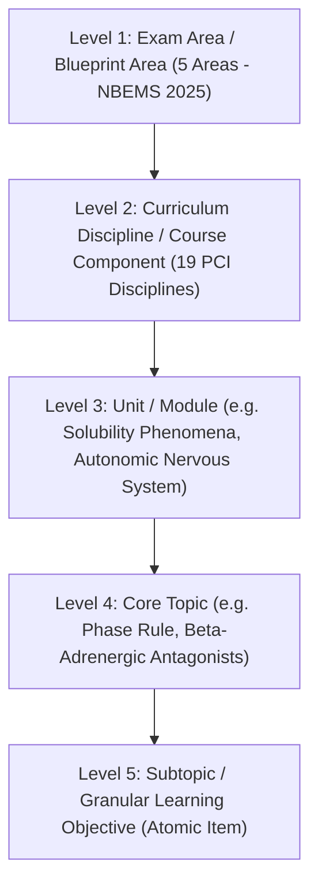

# Phase 17A: Authoritative Syllabus Reconciliation and Content Audit Decision

**Date:** 2026-10-18  
**Scope:** Canonical Syllabus Governance, Source Classification, PYQ Bank Integrity, and Staging Promotion Release Gates  
**Status:** Audit Complete — Human Decision Required Prior to Promotion

---

## 1. Executive Summary

This Phase 17A audit was performed to resolve the fundamental alignment between the official statutory curriculum (Pharmacy Council of India B.Pharm regulations) and the competitive entrance examination pattern (National Board of Examinations in Medical Sciences - GPAT).

### Summary Audit Metrics:
- **Registered Sources:** 7 total sources cataloged with cryptographic SHA-256 signatures, page counts, OCR status, and governance category.
- **Published Questions Audited:** 2,063 questions across GPAT 2010–2026 plus 47 expert benchmarks in `data/gpat_baseline.db`.
- **Quarantined Items Verified:** 89 defect items safely isolated in `pyq_review_queue` with zero leakage into the active question bank.
- **Staged Topic Mappings Inspected:** 2,016 candidate mappings in `data/pyq_topic_staging.db` (including 137 high-confidence candidate proposals), preserved strictly in staging.
- **Learner Protection Status:** Zero writes occurred against learner tables in `gpat_knowledge.db` (verified counts: `student_attempts` = 7, `fsrs_cards` = 11, `learner_achievements` = 4).

---

## 2. Answers to the Four Core Strategic Questions

### Question 1: What is the authoritative syllabus source for GPAT 2027?
**Audit Finding & Determination:**
- **PCI Institutional Curriculum vs. NBEMS GPAT Examination:**
  - **PCI Ref No. 14-154/2025-PCI:** The Pharmacy Council of India mandated the revised B.Pharm Syllabus under NEP 2020 for students admitted in the **academic session 2026–27 onward**. Existing batches (e.g. students graduating in 2027 who were admitted in 2023–24 or 2024–25) remain enrolled under the **PCI B.Pharm 2016–17 regulations**.
  - **NBEMS GPAT Statutory Reality:** NBEMS has **not yet published** the GPAT 2027 Information Bulletin. Historically, NBEMS tests the syllabus that the graduating cohort studied during their four-year degree. Therefore, GPAT 2027 candidates will have studied the 2016–17 curriculum.
- **Formal Decision:**
  - `CONFIRMED_CURRENT_BASELINE`: The official historical NBEMS syllabus (based on PCI 2016 regulations: 125 questions, 500 marks across 5 major subject groups).
  - `PENDING_CONFIRMATION`: The PCI NEP 2020 additions (e.g., AI in drug discovery, continuous biomanufacturing) must remain tagged as `NEW_IN_PCI_2026 / GPAT_APPLICABILITY_UNKNOWN` and held back from mandatory adaptive missions until official NBEMS confirmation.

### Question 2: Are the existing 221 topics sound, incomplete, or flawed?
**Audit Finding & Determination:**
- **Soundness:** The 221 topics accurately cover the traditional GPAT question papers from 2010 to 2026. All 2,063 published questions find a home within these 221 topics.
- **Structural Flaws Identified:**
  1. *Level 2 / Level 3 Conflation:* Level 2 curriculum disciplines (e.g., Physical Pharmacy, Biochemistry, Pharmaceutical Engineering) were collapsed into Level 3 unit labels.
  2. *Lexical Duplicates:* Topics such as `enzymes` and `carbohydrates` appear in multiple units without distinct domain qualifications.
  3. *Absence of Level 4 Subtopics:* All 221 topics currently have `parent_topic_id = NULL`, lacking subtopic granularity.
- **Formal Decision:**
  - The 221 baseline topics are sound as a *coarse-grained retrieval and coverage index*, but should be refactored into the 5-level canonical hierarchy before expanding to commercial multi-tenant scale.

### Question 3: Which PYQs are safe to serve in the pilot right now?
**Audit Finding & Determination:**
- **Safe to Serve (2,063 questions):**
  - All 2,016 historical GPAT questions (2010–2026) in `baseline_questions` have verified answer keys, structured options, and validated question stems.
  - All 47 expert benchmark questions (`q_gpat_001` to `q_gpat_047`) have verified explanations and active visual assets.
- **Unsafe / Quarantined (89 questions):**
  - The 89 items in `pyq_review_queue` have known defects: OCR option truncation (`INVALID_OPTION_COUNT`), missing option markers (`MISSING_OPTION_A_MARKER`), or ambiguous official answer keys (`QUESTION_DROPPED_OR_AMBIGUOUS_IN_OFFICIAL_KEY`).
- **Formal Decision:**
  - Pilot users (5 learners) will be served strictly from the 2,063 published items. The 89 quarantined items will remain blocked from practice missions.

### Question 4: Which candidate mappings are safe to promote vs. which require SME review?
**Audit Finding & Determination:**
- **Proposal Review:**
  - Phase 6.3 generated a candidate promotion proposal (`reports/phase6_3_mapping_promotion_proposal.csv`) containing 137 high-confidence classifier predictions.
  - However, human SME review has not signed off on all 137 items. An independent holdout test demonstrated that while subject-level accuracy is 96.4%, fine-grained unit/topic accuracy was 85.5%.
- **Formal Decision:**
  - **Zero automated promotion.** All 137 staged candidate mappings will remain in `data/pyq_topic_staging.db`.
  - Only mappings that receive explicit manual review recorded in `editorial_reviews` table will be promoted to production in future phases.

---

## 3. Five-Level Canonical Syllabus Hierarchy Architecture

To resolve the architectural limitations of the current 221-topic list, the following 5-level taxonomy model is adopted:

---

## 4. Immediate Safety Gate & Stop Condition

1. **No Production Database Mutations:** The audit scripts produced 4 CSV artifacts and this markdown decision report without altering `data/gpat_baseline.db` or `gpat_knowledge.db`.
2. **Review Barrier:** Progression to database schema restructuring or topic promotion is blocked pending human stakeholder confirmation of this decision report.

**Sign-off Status:** `AUDIT_COMPLETE_AWAITING_HUMAN_REVIEW`
