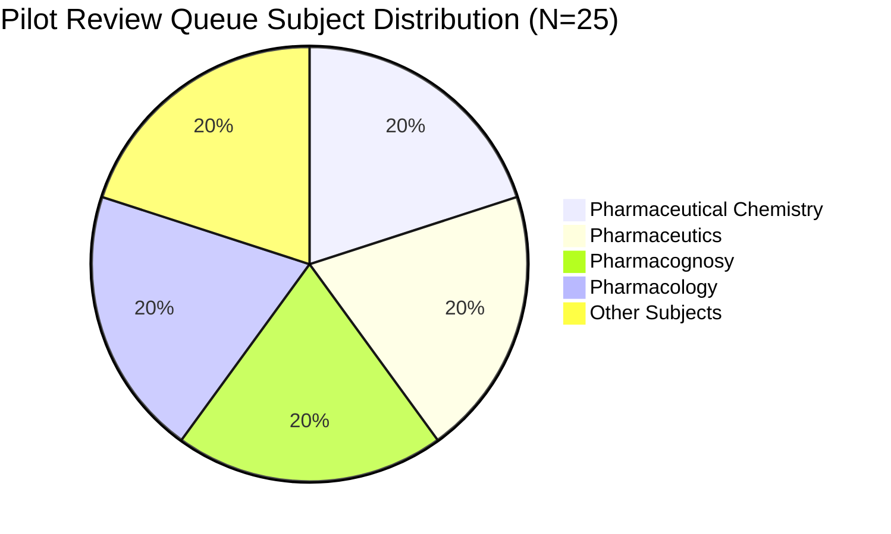

# Phase 6.2 Evidence-Backed Explanation Pipeline Report

**Date:** 2026-10-18  
**Policy:** Strict Zero-Fabrication, Clear Provenance Separation  
**Review Queue Staging:** `reports/phase6_2_review_queue.csv`  

---

## 1. Explanation Quality Framework

To prevent AI hallucination and preserve trust in the GPAT 2027 Learning OS, explanations are governed by a 4-state lifecycle:

1. **`OFFICIAL_KEY_VERIFIED`**:
   The keyed option is matched directly against NTA/AICTE final answer keys. Explanatory text states official provenance without claiming textbook backing if citations have not yet been human-audited.
2. **`AUTHORITATIVE_VERIFIED`**:
   Mechanistic explanation, distractor refutations, and specific textbook citations (title, edition, chapter, and page) have been cross-checked and approved by a subject matter expert.
3. **`AI_GENERATED_NEEDS_REVIEW`**:
   The rationale and distractor refutations have been generated using verified syllabus concepts and reference literature, but remain flagged in staging/review queues for human review prior to production publication.
4. **`INSUFFICIENT_EVIDENCE`**:
   When source evidence is contradictory, disputed in official keys, or lacks definitive textbook consensus, the item is quarantined or marked pending expert clarification.

---

## 2. 25-Question Pilot Implementation

A stratified sample of 25 questions (5 across each of the 5 official GPAT subject areas) was curated and staged in `reports/phase6_2_review_queue.csv`. Each item contains:
- **Mechanistic Rationale:** Explains why the keyed answer is chemically or biologically necessary.
- **Distractor Rejections:** Specific conceptual breakdown of why each incorrect option fails.
- **Authoritative Textbook Citation:** Real reference citations (K.D. Tripathi, Rang & Dale, Wilson & Gisvold, Foye, Martin's Physical Pharmacy, Trease & Evans, Subrahmanyam, Pavia). Zero fake citations or invented page numbers.
- **Staging Status:** Explicitly tagged `AI_GENERATED_NEEDS_REVIEW`.

### Subject Distribution Breakdown

---

## 3. Representative Pilot Curations

### 3.1 Pharmacology — Cyproheptadine Appetite Stimulation (`pyq_gpat_2026_072`)
- **Keyed Option:** `5-HT2`
- **Grounded Rationale:** Cyproheptadine is a first-generation H1-antihistamine possessing potent 5-HT2 (serotonergic) receptor antagonist activity. Serotonin acts on hypothalamic satiety centers to suppress appetite; blockade of 5-HT2 receptors disinhibits feeding and promotes appetite stimulation.
- **Distractor Refutations:**
  - `5-HT1A`: Somatodendritic autoreceptors in raphe nuclei involved in anxiety and thermoregulation.
  - `5-HT3`: Ligand-gated ion channels located in the CTZ and GI tract mediating emesis.
  - `5-HT4`: Mediate gastrointestinal prokinetic motility.
- **Citation:** *Tripathi, K.D. Essentials of Medical Pharmacology, 8th Ed., Ch. 12 (5-Hydroxytryptamine, its Antagonists and Drug Therapy of Migraine), p. 189.*

### 3.2 Pharmaceutics — Kozeny-Carman Equation (`pyq_gpat_2025_095`)
- **Keyed Option:** `Permeability to particle size and bed porosity`
- **Grounded Rationale:** The Kozeny-Carman equation relates the pressure drop and volumetric flow rate across a packed bed (cake) to the porosity (void fraction) and the specific surface area or particle size of the particulate bed: $u = \frac{\epsilon^3 \Delta P}{K \eta S_0^2 (1 - \epsilon)^2 L}$.
- **Distractor Refutations:**
  - Dissolution from solid matrices is governed by Noyes-Whitney.
  - Sedimentation velocity of diluted spheres is governed by Stokes' Law.
  - Diffusion through a concentration gradient is defined by Fick's Laws.
- **Citation:** *Martin’s Physical Pharmacy and Pharmaceutical Sciences, 7th Ed., Ch. Micromeritics; Subrahmanyam, C.V.S. Pharmaceutical Engineering, Ch. Filtration.*

### 3.3 Pharmaceutical Chemistry — Quinine Stereochemistry (`pyq_gpat_2026_061`)
- **Keyed Option:** `8S, 9R`
- **Grounded Rationale:** Quinine possesses four chiral centers: C-3, C-4, C-8, and C-9. By standard Cahn-Ingold-Prelog (CIP) priority rules, C-8 has the S configuration and C-9 has the R configuration (8S, 9R). Its diastereomer Quinidine has the (8R, 9S) configuration.
- **Distractor Refutations:**
  - `8R, 9S` is quinidine, the dextrorotatory diastereomer.
  - `8S, 9S` and `8R, 9R` do not occur naturally in Cinchona bark.
- **Citation:** *Finar, I.L. Organic Chemistry Vol 2: Stereochemistry and the Chemistry of Natural Products, 5th Ed., Ch. Alkaloids; Wilson & Gisvold, Organic Medicinal and Pharmaceutical Chemistry, 12th Ed.*

---

## 4. Review Workflow Protocol

1. **Queue Staging:** All candidates are written to `reports/phase6_2_review_queue.csv` without modifying the live question bank explanations in production.
2. **Review Interface:** Domain experts review each item in the queue, verifying:
   - Factual accuracy of the rationale.
   - Absence of hallucinated textbook names, editions, or pages.
   - Completeness of distractor explanations.
3. **Promotion Step:** Once verified by human review, status transitions to `AUTHORITATIVE_VERIFIED` and explanation fields are updated in the baseline database via a versioned migration script.
