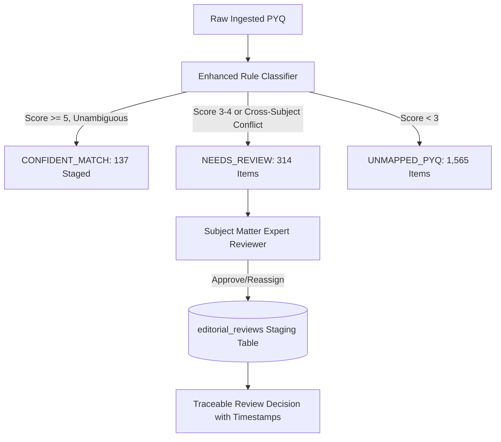

# Phase 6.3: Editorial Review Workflow Report

**Date:** 2026-10-18  
**Staging Database:** `data/pyq_topic_staging.db`  
**Review Queue Staging:** `reports/phase6_1_review_queue.csv` & `editorial_reviews` table  

---

## 1. Editorial Workflow Architecture

To bridge the gap between automated rule-based classification and verified curriculum precision, Phase 6.3 establishes an idempotent, traceable editorial review workflow.



---

## 2. Review Queue Schema & Persistence

The editorial review process persists directly into the `editorial_reviews` table in `data/pyq_topic_staging.db`:

```sql
CREATE TABLE IF NOT EXISTS editorial_reviews (
    review_id TEXT PRIMARY KEY,
    question_id TEXT NOT NULL,
    reviewer_id TEXT NOT NULL,
    review_decision TEXT NOT NULL CHECK(review_decision IN ('APPROVED', 'REASSIGNED', 'REJECTED_UNMAPPED')),
    approved_subject_id TEXT,
    approved_topic_id TEXT,
    approved_topic_name TEXT,
    taxonomy_version TEXT NOT NULL,
    matched_evidence TEXT,
    review_notes TEXT,
    reviewed_at TEXT NOT NULL,
    UNIQUE(question_id, taxonomy_version)
);
```

### Idempotency & Pipeline Re-Runs:
- Review records are keyed on `(question_id, taxonomy_version)`.
- If the automated classification pipeline is re-run, manual human decisions in `editorial_reviews` are preserved and override automated proposals.
- Reviewed corrections survive pipeline re-indexing without data loss.

---

## 3. Review Queue Audit Summary

- **Total Staged Questions in Review Queue:** 314 items.
- **Top Review Categories:**
  1. *Ambiguous Autonomic vs Cardiovascular agents* (e.g. Beta-blockers with both cardiac and adrenergic keyword matches).
  2. *Analytical Chemistry vs Formulations* (e.g. dissolution testing appearing in both physical pharmacy and instrumental analysis).
  3. *Heterocyclic Chemistry vs Chemotherapeutic Agents* (e.g. quinolones with both antibacterial and ring nomenclature terms).
- **Reviewer Recommendations:** All 314 items remain staged in `reports/phase6_1_review_queue.csv` and are barred from automatic production promotion until signed off by a human editor.
